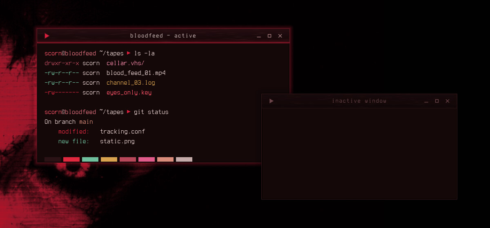
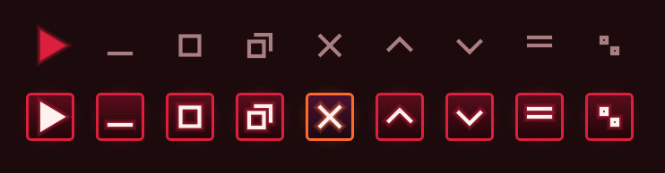

# Bloodfeed — Aurorae Window Decoration

A blood-black VHS window frame: a scanline title bar with tape-grain streaks, a crimson glow seam, a crimson-glow shadow and VCR transport buttons.



Bloodfeed is a blood-dubbed VHS look for KDE Plasma 6, built around a crimson-lit face on near-black: blood-black surfaces, faint scanlines and tape grain, and a slight crimson glow on whatever has focus.

## Features

- Title bar with faint scanlines and tape grain that stretches into horizontal VHS streaks.
- A crimson glow seam under the title, with a hot 1 px core.
- The active window casts a soft crimson glow; inactive windows dim to blood-black with a plain shadow.
- Square transport-style buttons that light up crimson on hover (close glows REC scarlet). The window-menu button is a VCR `▶ PLAY` triangle.
- Centred title, 3 px borders, no rounded corners.



## Requirements

KWin (Plasma 6) with Aurorae.

## Install

```bash
git clone https://github.com/numbpill3d/bloodfeed-aurorae
cd bloodfeed-aurorae && ./install.sh
```

Or from the KDE Store: System Settings → Colors & Themes → Window Decorations → Install from File, or extract to `~/.local/share/aurorae/themes/`.

## The rest of the suite

| piece | repo |
|---|---|
| SDDM login | [bloodfeed-sddm](https://github.com/numbpill3d/bloodfeed-sddm) |
| Plymouth boot splash | [bloodfeed-plymouth](https://github.com/numbpill3d/bloodfeed-plymouth) |
| Global theme + splash screen | [bloodfeed-global](https://github.com/numbpill3d/bloodfeed-global) |
| Plasma style (panel, popups) | [bloodfeed-plasma](https://github.com/numbpill3d/bloodfeed-plasma) |
| Colour scheme | [bloodfeed-colors](https://github.com/numbpill3d/bloodfeed-colors) |
| Kvantum widget style | [bloodfeed-kvantum](https://github.com/numbpill3d/bloodfeed-kvantum) |
| Icon theme | [bloodfeed-icons](https://github.com/numbpill3d/bloodfeed-icons) |
| Konsole + kitty colours | [bloodfeed-konsole](https://github.com/numbpill3d/bloodfeed-konsole) |

Everything at once, with the generators: [bloodfeed](https://github.com/numbpill3d/bloodfeed).

## Tags

`bloodfeed` `kde` `plasma6` `dark` `vhs` `scanlines` `crimson` `red` `blood` `horror` `retro` `analog-horror` `glow` `aurorae` `window-decoration` `kwin` `titlebar` `vcr-buttons`

## Credits and licence

By splicer scorn (voidrane). GPL-3.0-or-later.
